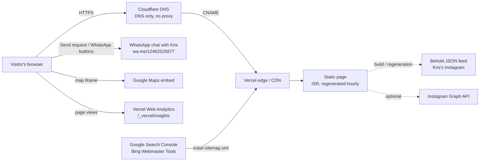
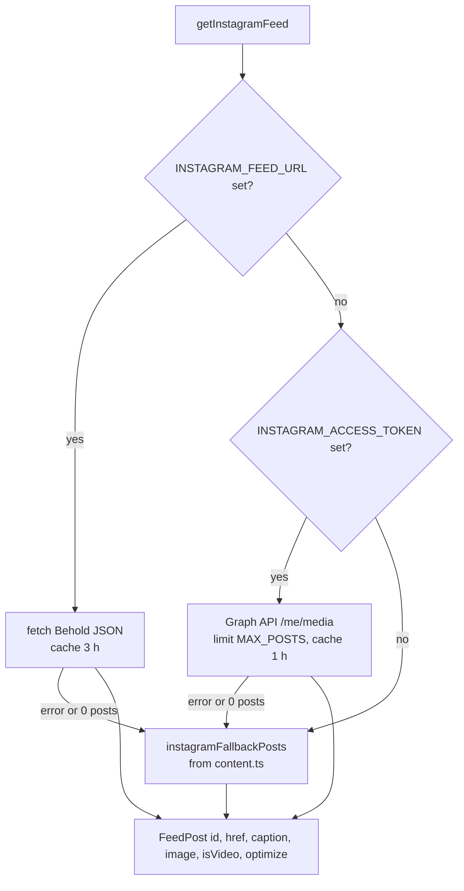

# Technical Design Document: Precision Welding Solutions website

| | |
| --- | --- |
| **System** | Marketing site for Precision Welding Solutions (Kris), Reece Rd, St. Thomas, Barbados |
| **Live URL** | https://www.precisionweldingsolutionsbb.com (the bare domain 308-redirects to `www`) |
| **Repository** | https://github.com/IeonChris/PrecisionWeldingSolutions (branch `main`) |
| **Owner / maintainer** | Christopher Maynard (beCALM Group LTD.) |
| **Document status** | Current as of 12 Oct 2026, commit `530481f` |

This document describes how the site is built and run: its architecture, the design of each part, how content and configuration flow through it, and the decisions and known limitations behind it. `README.md` is the day-to-day "how do I…" guide; this document is the "how does it work and why" reference.

---

## 1. Purpose and scope

**Goal.** Turn visitors into conversations with Kris. Every section leads to one of three actions: send a photo of the part on WhatsApp, call, or send a quote request (which also opens WhatsApp).

**Audience.** Mostly phone users in Barbados, arriving from Google, Instagram, Facebook and WhatsApp shares.

**In scope.** A single public page with sections (hero, services, about, why us, Instagram, contact), SEO for local search, a live Instagram feed, a WhatsApp-based quote request, visitor analytics.

**Out of scope (by design).**
- No CMS or admin area: all copy and photos live in `src/content.ts` and change through a commit.
- No server-side form handling, email or database: quote requests go straight to WhatsApp from the visitor's own device.
- No cookies, accounts or payments.
- No "machining" or "machinist" anywhere: Kris markets himself as a welder and fabricator only.

---

## 2. System overview



| Concern | Service | Notes |
| --- | --- | --- |
| Hosting, CDN, builds | **Vercel** (Hobby), project `precision-welding-solutions` | Deploys automatically on every push to `main` |
| Domain registration | **Vercel** | `precisionweldingsolutionsbb.com`, auto-renews 12 Oct 2027 |
| DNS | **Cloudflare** (`anuj` / `hera.ns.cloudflare.com`) | `CNAME @` and `CNAME www` → `023b47b5627eb4da.vercel-dns-017.com`, **DNS only** |
| TLS certificates | Let's Encrypt, issued and renewed by Vercel | Requires the Cloudflare proxy to stay off |
| Instagram feed | **Behold** (free plan), Kris's account | 6 posts, refreshed once a day by Behold |
| Analytics | **Vercel Web Analytics** (Hobby) | Cookieless page views, 1-month history |
| Search | **Google Search Console**, **Bing Webmaster Tools** | Sitemap submitted; status "Success" |
| Source control | GitHub `IeonChris/PrecisionWeldingSolutions` | |

---

## 3. Technology stack

| Layer | Choice | Version (installed) |
| --- | --- | --- |
| Framework | Next.js (App Router), React | 15.5.26, 19.3.0 |
| Language | TypeScript (strict) | 5.9.3 |
| Styling | Tailwind CSS v4 (`@theme` tokens, `@utility` classes), default palette disabled | 4.3.3 |
| Fonts | Montserrat (headings), Open Sans (body) via `next/font/google`, self-hosted at build | — |
| Images | `next/image` (AVIF/WebP), `sharp` for the share card | sharp 0.35.5 |
| Analytics | `@vercel/analytics` | 2.0.1 |
| Lint | ESLint 9 with `eslint-config-next` | 9.39.5 |
| Runtime | Node.js (local) | 22.14.0 |

Production dependencies are deliberately few: `next`, `react`, `react-dom`, `sharp`, `server-only`, `@vercel/analytics`.

---

## 4. Repository layout

```
src/
  app/
    layout.tsx              Root layout: fonts, site metadata, LocalBusiness JSON-LD, <Analytics />
    page.tsx                The page: section order, Instagram fetch, ISR (revalidate = 3600)
    globals.css             Design tokens (@theme), utilities, Instagram ring CSS
    opengraph-image.tsx     1200×630 share card, rendered once at build (Node + sharp → JPEG)
    sitemap.xml/route.ts    Hand-written sitemap (page + image entries), static
    robots.ts               robots.txt
    not-found.tsx           404 page
    api/seo/ping/route.ts   Protected sitemap ping (PING_SECRET)
    icon.png, apple-icon.png
  components/
    sections/               Hero, Services, About, WhyUs, InstagramFeed, Contact
    SiteNav, ShopStatus, MobileActionBar, FloatingWhatsApp, SiteFooter, Brand
    HeroMedia, InstagramRing, MotionToggle, QuoteForm
    FixedBackground, SiteImage, ImagePlaceholder, Icons, JsonLd
  lib/
    instagram.ts            Feed fetching (Behold / Graph API / fallback), server-only
    metadata.ts             baseUrl, createMetadata, JSON-LD builders
    whatsapp.ts             Every wa.me link is built here
  assets/fonts/             TTFs + OFL licences for the share card
  content.ts                ALL copy, contact details, hours, photos, messages
public/
  images/                   Kris's photos, logo, share photo
  media/hero-cutting.mp4    6 s silent hero loop
scripts/
  build-exfat.cjs, exfat-fs-fix.cjs   Production builds on the exFAT dev drive
  lighthouse.mjs                       Local Lighthouse runner
  instagram-refresh-token.mjs          Rotates a Graph API token (only if that source is used)
design_handoff/             Original handoff and v3 redesign reference (not part of the build)
```

---

## 5. Rendering and data flow

### 5.1 Page rendering

- `/` is **statically generated with ISR**: `export const revalidate = 3600` in `src/app/page.tsx`. Vercel serves the cached HTML from its CDN and regenerates it in the background at most once an hour, when a request arrives.
- The only data fetched at render time is the Instagram feed (5.2). Everything else comes from `src/content.ts` at build time.
- Interactive parts are small client components (`"use client"`): `HeroMedia`, `InstagramRing`, `ShopStatus`, `SiteNav` (mobile menu), `QuoteForm`, `MotionToggle`. The page's own JavaScript is about 8.7 kB on top of Next's 103 kB shared runtime.

### 5.2 Instagram feed (`src/lib/instagram.ts`)



- **Source in production: Behold** (`INSTAGRAM_FEED_URL`, set in Vercel and `.env.local`). Behold's free plan returns up to **6 posts**, updates once a day, and allows **1,200 feed requests a month**. The Behold response is therefore cached for 3 hours (`BEHOLD_REVALIDATE_SECONDS`, at most ~250 requests a month) even though the page regenerates hourly.
- **Option B: Instagram Graph API** (`INSTAGRAM_ACCESS_TOKEN`): `GET /me/media?fields=id,caption,media_type,media_url,thumbnail_url,permalink&limit=12`, cached 1 hour. The token expires after 60 days unless rotated with `npm run instagram:refresh`. Videos use `thumbnail_url`.
- **Normalisation:** captions are cut to the first line with hashtags removed (`tidyCaption`, max 90 characters). For Behold, `beholdImage` picks the smallest rendition whose *shorter* side is at least 520 px (square tiles crop to the shorter side; 260 px tiles at 2×).
- **Image delivery:** Behold images are already resized WebP and are rendered unoptimised; Graph API images go through `next/image` (allowed hosts in `next.config.ts`).
- **Security:** the module imports `server-only`; tokens and feed URLs never reach the browser, which receives only the `FeedPost` fields. Errors are logged without the request URL (it can carry the token).
- **Post cap:** `MAX_POSTS = 12`. Above about 12 the ring becomes a wide, shallow arc.

### 5.3 Build-time assets

| Asset | Source | How it's made |
| --- | --- | --- |
| Share image `/opengraph-image` | `src/app/opengraph-image.tsx` | `next/og` renders a PNG at build (Node runtime, `force-static`); `sharp` re-encodes it as a ~69 KB JPEG, because WhatsApp drops link-preview images over ~300 KB. Fonts come from `src/assets/fonts`, never the network. |
| `/sitemap.xml` | `src/app/sitemap.xml/route.ts` | Static route handler; see 9.3. |
| `/robots.txt` | `src/app/robots.ts` | Allows all, disallows `/admin` and `/api/`, points to the sitemap. |
| Icons | `src/app/icon.png`, `apple-icon.png` | Cropped from the logo emblem. |

### 5.4 Canonical URL resolution (`src/lib/metadata.ts`)

`baseUrl` is resolved in this order: `NEXT_PUBLIC_SITE_URL` (optional override) → **production on Vercel uses `business.url`** (`https://www.precisionweldingsolutionsbb.com`) → Vercel previews use their own `VERCEL_URL` → `next dev` uses `http://localhost:3000` → otherwise `business.url`. Canonical tags, Open Graph URLs, JSON-LD IDs, the sitemap and robots.txt all derive from it.

---

## 6. Page composition

Sections in order (`src/app/page.tsx`), with anchors used by the nav:

| # | Component | Anchor | What it does |
| --- | --- | --- | --- |
| — | `<div id="top">` | `#top` | Target for the logo and footer "Home". It is *not* the sticky header: a stuck sticky element is always on screen, so the browser would never scroll to it. |
| 1 | `SiteNav` | — | Sticky header (69 px): logo, links, and from 832 px a WhatsApp button; from 1100 px `ShopStatus`. Below 832 px a hamburger menu (Escape closes it and returns focus). |
| 2 | `Hero` + `HeroMedia` | — | Fills the screen below the nav: `min-height: max(560px, 100svh − 69px)`, and below 832 px also above the 69 px bottom bar (`− 138px`). Headline, "Send a photo on WhatsApp" + "Call", proof row. |
| 3 | `Services` | `#services` | Sticky intro (from 768 px) beside six service rows; each row opens WhatsApp prefilled with that service. |
| 4 | `About` | `#about` | Kris's portrait with a name plate, story, four points. |
| 5 | `WhyUs` | `#why` | Four reasons, each with one of Kris's job photos (4:5 cards). |
| 6 | `InstagramFeed` + `InstagramRing` | `#work` | Header (avatar, handle, Follow button) and the 3D ring of latest posts. |
| 7 | `Contact` (`FixedBackground`) | `#contact` | Shop-front photo held still behind the content; address, phone, hours, Google map, `QuoteForm`. |
| 8 | `SiteFooter` | — | Three columns, hours, credit line. |
| — | `MobileActionBar` | — | Below 832 px: fixed Call / Send a photo bar (69 px) plus a 72 px spacer so it never covers the footer. |
| — | `FloatingWhatsApp` | — | From 832 px: floating WhatsApp button. |
| — | `JsonLd` | — | `ItemList` + `Service` structured data (`LocalBusiness` is in the layout). |

---

## 7. Content model (`src/content.ts`)

Every visitor-facing string, link, photo and setting lives here, so content changes never touch component code.

| Export | Drives |
| --- | --- |
| `business` | Name, `url` (canonical domain), description, phone (`display`, `e164`, `href`), `whatsappUrl`, Instagram, address, geo, map query, **hours** (`days`, `note`, `footer`, `schema`, `utcOffsetHours: -4`), credit |
| `whatsappMessages` | Prefilled texts: `photo`, `service` (`{service}`), `quote` (`{name}`, `{phone}`, `{job}`) |
| `images` | `logo`, `hero`, `about`, `contactBg`, `share`: each a `SiteImage` (`src`, `alt`, `placeholder`, `position`); `src: null` shows a captioned placeholder |
| `heroVideo` | Loop source and `desktopLayout` (`"panel"` for the portrait clip); `null` = photo only |
| `navLinks`, `footerLinks`, `nav`, `mobileBar` | Navigation labels and the open/closed status templates (`{time}`, `{day}`) |
| `hero`, `servicesIntro`, `services`, `about`, `whyIntro`, `reasons` | Section copy; `reasons[i].image` are the Why-us photos |
| `instagramIntro`, `instagramFallbackPosts` | Instagram labels (including the ring's pause/play names) and the no-feed fallback |
| `contact`, `footer` | Contact copy and the quote form's labels, hints and messages |

**Single sources of truth:** `business.hours.schema` drives both the JSON-LD `openingHoursSpecification` and the nav status (the display strings `hours.days`, `hours.note` and `hours.footer` are written separately and must be kept in step with it); `images`/`reasons` feed both the page and the sitemap's image entries; every WhatsApp link goes through `src/lib/whatsapp.ts`.

---

## 8. Component design

### 8.1 `HeroMedia` (hero video)
- The poster photo is server-rendered and `priority`-loaded; the silent 6 s H.264 loop (1 MB, `public/media/hero-cutting.mp4`) starts only after `window.load`, so it never competes with first paint.
- Pauses while off screen (IntersectionObserver). Never autoplays under `prefers-reduced-motion` or Data Saver.
- Desktop "panel" layout: the portrait clip fills the right half and fades into the black behind the headline (`hero-fade` mask).
- Pause/play via the shared `MotionToggle` (WCAG 2.2.2).

### 8.2 `InstagramRing` (3D carousel)
- **Geometry.** A zero-size `preserve-3d` list sits at 44 % of the stage height; tile *i* is placed at `rotateY(i · 360°/S) translateZ(R)` with `R = (tile / 2) / tan(π / S) + gap`. Tile 260 px / gap 40 px (180 px / 28 px below 900 px). `R` is computed in CSS with `tan()` for the first paint and recomputed in JS from the CSS variables on resize.
- **Slots.** With fewer than 9 posts each post appears twice (Behold's 6 → 12 slots). Copies sit 180° apart, so the twin is always on the hidden back face; the back copy is `inert`, so keyboard and screen-reader users get one stop per post.
- **Stage.** `perspective: 1900px` (1200 px below 600 px), origin 50 % 40 %, tilt `rotateX(-7deg)`. Floor: `-webkit-box-reflect` below 14 px (WebKit/Blink, 600 px and up), a blurred blue radial glow and a faint blue wash over the bottom 46 %.
- **Motion** (requestAnimationFrame, no CSS animation). Auto-spin 0.12°/frame at 60 fps, scaled by frame time so 120 Hz screens spin at the same speed. Drag: pointer movement on `window`, 0.15° per pixel, then ease back to the auto speed (`v += (target − v) · 0.03`). Pauses on tile hover and while a tile has focus. The loop runs only while the stage is on screen.
- **Clicks vs drags.** A press that travels more than 5 px doesn't open the post. Keyboard activation (`detail === 0`) always does.
- **Keyboard.** Focusing a tile turns it to the front; ←/→ move to the neighbouring tile.
- **Reduced motion / WCAG 2.2.2.** A `MotionToggle` pauses the spin; under `prefers-reduced-motion` the ring starts paused (Play is offered) and focus turns snap instead of easing. Dragging always works.
- **Touch.** `touch-action: pan-y` (not `none`), so vertical swipes still scroll the page on phones while horizontal drags turn the ring.
- **Captions.** First line of the caption on hover/focus over a near-solid dark strip (reels often have text burned in at the bottom); posts without a caption get only a screen-reader name. Videos show a play badge.

### 8.3 `ShopStatus` (open/closed in the nav)
- Client-only, recalculated every minute, in Barbados time (UTC−4 all year, no daylight saving).
- If inside a `business.hours.schema` window: "Open now · until {closing time}" (green). Otherwise it scans forward up to 7 days for the next opening: "Opens today 8 AM", "Opens tomorrow 8 AM" or "Opens {weekday} …" (amber).
- Rendered `invisible` until mounted, holding the label's width, so the HTML never shows a stale state and the nav doesn't shift.

### 8.4 `QuoteForm` (WhatsApp quote request)
- Fields: Name, Phone / WhatsApp (at least 7 digits, enforced with `setCustomValidity`), Describe the job; all required.
- "Send request" builds `whatsappMessages.quote` with the values (replacer functions, so a `$` the visitor types is kept literally) and opens `wa.me/12462525877?text=…` in a new tab (phones hand it to the WhatsApp app). If the pop-up is blocked it navigates the current tab instead.
- WhatsApp links cannot carry files, so the message ends "Photo attached below 👇" and the note under the button asks the visitor to add the photo in the chat. A "Didn't open? Tap here" link appears after sending.
- Nothing is sent to or stored on the server; a request only reaches Kris if the visitor presses send in WhatsApp.

### 8.5 Other components
- **`FixedBackground`**: section with `clip-path: inset(0)` around a `position: fixed` photo layer, so the photo stays still while content scrolls (works on iOS, unlike `background-attachment: fixed`).
- **`SiteImage`**: wraps `next/image` with `fill`, `sizes`, `object-position` from content; renders `ImagePlaceholder` when `src` is null.
- **`MotionToggle`**: shared 44 px round pause/play button for the hero video and the ring.
- **`MobileActionBar` / `FloatingWhatsApp`**: mutually exclusive at the 832 px `nav` breakpoint.

---

## 9. SEO

### 9.1 Metadata
- Title "Precision Welding Solutions | Welding & Fabrication in Barbados", description from `business.description`, canonical URL, Open Graph (`en_BB`) and Twitter `summary_large_image` tags via `createMetadata`.
- The share card is the build-time JPEG at `/opengraph-image`.

### 9.2 Structured data (JSON-LD)
- `LocalBusiness` (layout): name, phone, address, geo (plus code 5C42+G6), map link, Mon–Sat 08:00–17:00 and Sun 08:00–13:00 hours, area served, Instagram `sameAs`.
- `Service` with an `OfferCatalog` of the six services, and the same services as an `ItemList` (page).
- `createBreadcrumbSchema` exists for future sub-pages; there are none yet.

### 9.3 Sitemap
- One URL (`/`) plus seven `image:image` entries (hero, About, the four Why-us photos, shop front), taken from `content.ts`.
- Hand-written in a route handler because Next 15.5's `sitemap.ts` emits image entries *before* `<lastmod>`, which fails the sitemaps.org schema; Search Console reported that version as "could not be read". The current file validates against the sitemaps.org and Google image XSDs.
- `<lastmod>` is the build time, which on Vercel is the time of the last deploy.

### 9.4 Search engines
- Google Search Console: domain property verified; sitemap submitted (status **Success**, 1 page); indexing requested for `/`.
- Bing Webmaster Tools: imported from Search Console; sitemap added; indexing requested.
- `/api/seo/ping` (protected by `PING_SECRET`) still pings Bing; Google retired its ping endpoint in 2023 and answers 404.

---

## 10. Security

| Control | Implementation |
| --- | --- |
| Transport | HTTPS only (Vercel, Let's Encrypt). |
| Content-Security-Policy | `default-src 'self'`; `script-src 'self' 'unsafe-inline'`; `style-src 'self' 'unsafe-inline'`; `img-src 'self' data: blob:` + `behold.pictures`, `*.cdninstagram.com`, `*.fbcdn.net`; `font-src`, `media-src`, `connect-src 'self'`; `frame-src` Google Maps; `object-src 'none'`; `base-uri`, `form-action 'self'`; `frame-ancestors 'none'`. |
| Other headers | `X-Content-Type-Options: nosniff`, `X-Frame-Options: DENY`, `Referrer-Policy: strict-origin-when-cross-origin`, `Permissions-Policy: camera=(), microphone=(), geolocation=()`; `X-Powered-By` disabled. |
| Secrets | `INSTAGRAM_ACCESS_TOKEN`, `INSTAGRAM_FEED_URL` and `PING_SECRET` are server-only (Vercel env vars, `.env.local` locally, git-ignored). |
| Data handling | No personal data is collected or stored by the site. The quote form runs entirely in the browser; analytics are cookieless. |
| JSON-LD | Serialised with `<` escaped (`<`) to prevent script injection. |

**Trade-off:** `'unsafe-inline'` scripts are required because the page is pre-rendered (ISR) and Next.js inlines small bootstrap scripts; a nonce-based CSP would force every request to render on the server. The policy still restricts *where* scripts, images, frames and fonts can load from.

---

## 11. Performance

| Technique | Where |
| --- | --- |
| Static HTML from the CDN, hourly ISR | `page.tsx` |
| Inlined CSS (no stylesheet round trip) | `experimental.inlineCss` |
| Self-hosted fonts with `display: swap`, preloaded | `next/font` (preload links are emitted on Vercel's Linux builds) |
| Responsive AVIF/WebP images with `sizes`; priority hero poster | `next/image`, `SiteImage` |
| Hero video only after `load`, paused off screen, never under Data Saver | `HeroMedia` |
| Below-the-fold sections skip layout/paint until near the viewport | `cv-auto` utility (`content-visibility: auto` + measured `--cv-h` estimates; never on `.fixed-bg` sections) |
| Instagram images lazy-loaded; ring animation only while on screen | `InstagramRing` |
| Long-lived caching for `/images` and `/media` (30 days + SWR) | `next.config.ts` |

**Measured (local Lighthouse, Windows):** accessibility 100, best practices 100, SEO 100 on mobile and desktop; desktop performance ~95–97. Local mobile performance numbers are unreliable on the dev machine (see 15); measure the live site with PageSpeed Insights.

---

## 12. Accessibility

- Target: Lighthouse accessibility 100 (met).
- Colour: any blue fill that carries text uses `blue-strong #1a73d0` (4.77:1 with white) or the ring's `ig-blue #1f74d6` (4.64:1); `#6b7480` is lifted to `#77808c` for text.
- Motion: hero video and Instagram ring both have pause/play controls (WCAG 2.2.2) and respect `prefers-reduced-motion`.
- Keyboard: skip link to `#main`; visible `:focus-visible` outlines; mobile menu closes on Escape and returns focus; ring is fully keyboard-operable with one tab stop per post.
- Touch targets ≥ 44 px on phones; form inputs 16 px on phones (no iOS zoom).
- Screen readers: decorative images have empty `alt`; Instagram tiles are named "Instagram post: {caption}"; the open/closed status never announces a stale state.

---

## 13. Design system

- **Tokens** (`@theme` in `globals.css`, the only colours available): surfaces `base #0a0b0d`, `panel #0f1216`, `deep`, `slot`; lines `line`, `field`, `outline`, `faint`; brand `blue #1e7fe0`, `blue-strong`, `blue-light #3b9dff`, `blue-hover`; `whatsapp #25d366` (+ hover, ink); `amber` (closed dot only); text `fg`, `silver`, `muted`, `dim`, `faint-fg`; Instagram section `ig-bg`, `ig-line`, `ig-blue`, `ig-blue-hover`, `ig-eyebrow`.
- **Type:** Montserrat 500–800 (`font-display`, uppercase `display` role), Open Sans 400–600 (body). The share card uses bundled TTFs of the same fonts.
- **Breakpoints:** `xs` 480, `sm` 640, `md` 768, `nav` 832 (full nav vs. hamburger + bottom bar), `lg` 1024, `wide` 1100 (nav status, four-up Why-us cards); the ring uses 900 and 600 px.
- **Utilities:** `btn`, `btn-primary`, `btn-outline`, `btn-ghost`, `link-quiet`, `eyebrow`, `display`, `container-site`, `section-pad`, `fixed-bg`, `cv-auto`, `hero-fade`, `hero-scrim`, `field`.
- **Motion rules:** only `transform` and `opacity` animate; spring easing `cubic-bezier(0.22, 1, 0.36, 1)`; never `transition-all`.
- **References:** `design_handoff/Redesign v3.dc.html` (the v3 baseline, matched within 1 px at 1280 px when implemented; the Instagram ring, full-screen hero and WhatsApp form have since changed by request) and the original handoff beside it.

---

## 14. Configuration

### 14.1 Environment variables

| Variable | Used by | Production value / notes |
| --- | --- | --- |
| `INSTAGRAM_FEED_URL` | `lib/instagram.ts` | Kris's Behold JSON feed URL (set in Vercel). Treat as private: anyone with it can use up the plan's monthly requests. |
| `INSTAGRAM_ACCESS_TOKEN` | `lib/instagram.ts` | Unset (only for the Graph API option). |
| `PING_SECRET` | `/api/seo/ping` | Long random string. |
| `NEXT_PUBLIC_SITE_URL` | `lib/metadata.ts` | Unset; optional override of the canonical URL. |

`.env.local.example` documents them; `.env.local` is git-ignored.

### 14.2 External settings that must stay as they are
- **Cloudflare:** both CNAME records on **DNS only** (grey cloud). Turning the proxy on breaks Vercel's certificate issuance and can cause redirect loops.
- **Vercel Domains:** `precisionweldingsolutionsbb.com` → 308 → `www.precisionweldingsolutionsbb.com` (Production).
- **Vercel Analytics:** enabled on the project.

---

## 15. Build, test and deploy

### 15.1 Commands

```bash
npm run dev            # local dev server, http://localhost:3000
npm run build          # production build (Linux/macOS, Vercel)
npm run build:exfat    # production build on the exFAT dev drive (F:)
npm run start          # serve the production build
npm run lint           # ESLint
npm run typecheck      # tsc --noEmit
npm run lighthouse     # mobile + desktop Lighthouse against a running build
```

### 15.2 Deployment
Push to `main` → Vercel builds and deploys to Production automatically (about 1–2 minutes). Preview deployments use their own URLs and canonicals. Rollback: promote an earlier deployment in the Vercel dashboard, or `git revert` and push.

### 15.3 Verification
There is no automated test suite. Each change is verified before committing by:
1. `npm run lint`, `npm run typecheck`, and a production build.
2. Running the production build locally and checking the change in a real browser (headless Chrome scripts for interactions, layout at 360–1440 px, CSP violations and console errors).
3. Lighthouse for accessibility, best practices and SEO; PageSpeed Insights on the live site for performance.
4. After deploy: checking the live URL (status, canonical, sitemap validity, certificates).

### 15.4 Development environment quirks (Windows, exFAT drive)
- `next build` fails on exFAT with `EISDIR … readlink`; `build:exfat` preloads a shim through `NODE_OPTIONS` (forward-slash path) so Next's workers get it too.
- Next 15.5's font manifest plugin matches forward-slash paths, so **Windows builds emit no font preload links** (Vercel's Linux builds do). Local runs can show a one-off layout shift that production doesn't have.
- Local Chrome reports decoded sizes as transfer sizes, so Lighthouse's simulated throttling under-reports mobile performance; use `--throttling-method=devtools` and compare builds side by side.
- Tailwind classes added while `next dev` is running on exFAT sometimes don't generate until the dev server restarts.
- Locally `/_vercel/insights/script.js` returns 404 (it only exists on Vercel).

---

## 16. Operations and maintenance

| Task | How | When |
| --- | --- | --- |
| Change hours, phone, copy, services | Edit `src/content.ts`, commit, push | As needed (for hours, update `hours.schema` *and* the `days`/`note`/`footer` strings) |
| Swap a photo | Add to `public/images/`, update the `src`/`alt`/`position` in `content.ts` (the sitemap follows) | As needed; ask Kris for originals sent "as Document" |
| Replace the hero loop | ffmpeg recipe in README → `public/media/hero-cutting.mp4` + poster | As needed |
| Instagram feed | Automatic via Behold; nothing to do | Behold refreshes daily |
| Graph API token (only if used) | `npm run instagram:refresh`, paste into Vercel | Every < 60 days |
| Domain renewal | Auto-renew on Vercel | 12 Oct 2027 ($10.46/yr; Verisign raises .com to $11.17 from 1 Nov 2026) |
| Search performance | Search Console and Bing → Performance; fix issues they report | Monthly |
| Visitor stats | Vercel → Analytics (only 1 month kept on Hobby; screenshot to archive) | Monthly |
| Dependencies | Update Next/React/Tailwind; re-run lint, typecheck, build, and the checks in 15.3 | Quarterly, or for security advisories |

---

## 17. Known limitations

| Limitation | Impact | Possible remedy |
| --- | --- | --- |
| WhatsApp links can't carry files | The customer attaches the photo manually in the chat | Upload to storage and send a link (needs Vercel Blob) |
| Behold free plan: 6 posts, daily refresh, 1,200 requests/month | Ring shows each post twice; new posts appear within ~a day | Behold Starter ($10/mo, 50 posts, hourly) or the Graph API |
| Vercel Analytics Hobby: page views only, 1-month history, no custom events | WhatsApp/quote taps aren't counted; bounce rate reads ~100 % on a one-page site | Vercel Pro ($20/mo) for custom events |
| CSP needs `'unsafe-inline'` scripts | Weaker against injected inline scripts | Nonce CSP via middleware, at the cost of static/ISR rendering |
| No automated tests | Regressions are caught by manual/scripted checks only | Add Playwright tests for the form, ring and nav status |
| `-webkit-box-reflect` is unsupported in Firefox | No floor reflection in Firefox | Acceptable by spec |
| Photos are WhatsApp-compressed (1200–2000 px) | Slightly soft on large screens | Originals sent as Documents |
| About photo shows a "Rude Boy" cannabis-leaf shirt print | Content decision for the client | Replace with a plain work-shirt portrait if Kris prefers |

---

## 18. Decision log

| Date | Decision | Why |
| --- | --- | --- |
| 2026-09-28 | Next.js 15 App Router + Tailwind v4, one page, all content in `content.ts` | House stack; non-developers' edits stay in one file; static and fast |
| 2026-09-28 | Share image rendered at build on Node and re-encoded as JPEG | WhatsApp drops link previews over ~300 KB; a PNG photo card was ~650 KB |
| 2026-10-05 | Kris's own photos/video; remove "machinist"/"machining" everywhere | Real work builds trust; Kris focuses on welding and fabrication |
| 2026-10-07 | v3 redesign: problem-led hero, service rows to WhatsApp, mobile action bar, nav status | Design review; more direct paths to WhatsApp |
| 2026-10-07 | Behold free plan as the Instagram source, cached 3 h | No token upkeep; stays well inside 1,200 requests/month |
| 2026-10-08 | Instagram section as a 3D ring; 12 slots (posts twice) rather than 6 × 340 px | Compared renders: 6 big tiles showed only three at once |
| 2026-10-08 | Ring `touch-action: pan-y` instead of `none`; pause button added | Phones must still scroll past it; WCAG 2.2.2 |
| 2026-10-08 | Bundle the share-card fonts | A failed Google Fonts download broke the Vercel build |
| 2026-10-08 | Hours = Google listing (Mon–Sat 8–5, Sun 8–1); status computed from the schedule | Original brief was wrong; one source of truth |
| 2026-10-12 | Quote form → WhatsApp; email (Resend/React Email), server action, rate limiter and zod removed | Email was never configured (live form errored); Kris works on WhatsApp; nothing to maintain |
| 2026-10-12 | Domain `precisionweldingsolutionsbb.com`, `www` canonical | The plain `.com` is owned elsewhere (to 2031); `www` matches Vercel's default redirect |
| 2026-10-12 | Content-Security-Policy with `'unsafe-inline'` scripts | Keeps static/ISR rendering |
| 2026-10-12 | Hand-written sitemap with image entries | Next's output failed the schema; Search Console couldn't read it |
| 2026-10-12 | Vercel Web Analytics (Hobby) | Free, cookieless, no consent banner |

---

## 19. Change history

| Commit | Date | Change |
| --- | --- | --- |
| `530481f` | 2026-10-12 | Add Vercel Web Analytics |
| `e799d32` | 2026-10-12 | Write the sitemap by hand so it passes the sitemap schema |
| `119561b` | 2026-10-12 | List Kris's job photos in the sitemap |
| `ab9fa7d` | 2026-10-12 | Send quote requests to WhatsApp, use the new domain, add a CSP |
| `93ce61c` | 2026-10-09 | Trim the hero eyebrow and drop the footer's serving line |
| `bc0af4a` | 2026-10-08 | Correct the opening hours to match the Google listing |
| `6fcb2d3` | 2026-10-08 | Fill the screen with the hero and fix the logo's back-to-top link |
| `39beed5` | 2026-10-08 | Fix the Vercel build (share image fonts) and add a pause button to the ring |
| `ad41a9c` | 2026-10-08 | Redesign the Instagram section as an interactive 3D ring |
| `25cf2a9` | 2026-10-08 | Use new photos of Kris at work in the Why us cards |
| `9a0eb4c` | 2026-10-07 | Tune the Instagram grid for Kris's live Behold feed |
| `62340c8` | 2026-10-07 | Redesign the site to the v3 direction |
| `5d2a522` | 2026-10-05 | Use Kris's own photos and video; drop machining |
| `5d8f0e5` | 2026-09-29 | Build Precision Welding Solutions one-page site |
